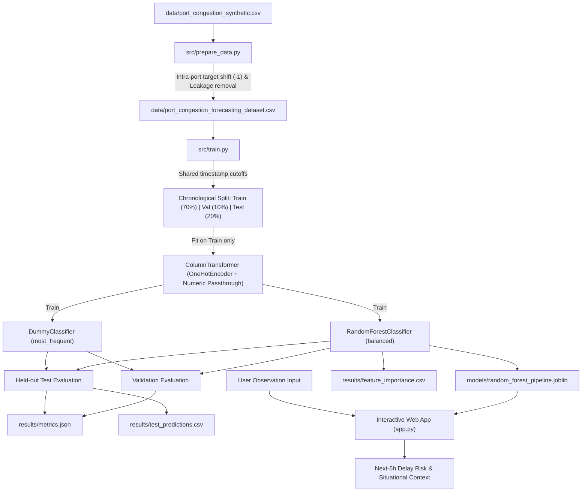

# System Architecture

## High-Level System Structure

This system implements an interpretable machine learning pipeline to forecast simulated port congestion and shipping delays for the upcoming six-hour operational window.

### 1. Major Components

- **Data Ingestion & Alignment Pipeline (`src/prepare_data.py`)**:
  - Reads raw operational simulation logs.
  - Groups and sorts records by port identifier and chronological timestamp.
  - Constructs forward-shifted target variables (`target_delayed_next_6h` and `target_actual_delay_hours`) strictly within port boundaries.
  - Eliminates horizon boundaries (terminal records per port lacking next-interval targets).
  - Drops current-interval outcome columns to ensure zero target leakage into downstream features.
  - Persists the validated forecasting dataset.

- **Model Training & Evaluation Pipeline (`src/train.py`)**:
  - Partitions dataset into chronologically ordered training (~70%), validation (~10%), and test (~20%) sets using shared timestamp cutoffs.
  - Assembles and fits scikit-learn preprocessing transformers (`ColumnTransformer` with `OneHotEncoder` for categorical predictors and numeric passthrough) strictly on the training partition.
  - Trains a zero-intelligence baseline (`DummyClassifier` with `most_frequent` strategy) and the primary model (`RandomForestClassifier` with balanced class weights).
  - Evaluates both models against validation and held-out test partitions using classification metrics (Accuracy, Precision, Recall, F1-score, ROC-AUC, Confusion Matrix).
  - Exports the trained model artifact, performance metrics, feature importances, and held-out test predictions.

- **Threshold Tuning & Evaluation (`src/evaluate_thresholds.py`)**:
  - Evaluates candidate probability thresholds on validation data to balance precision and recall.
  - Identifies operational threshold choices (e.g. 0.40 for high sensitivity vs. 0.50 default).
  - Applies fixed recommended threshold to held-out test data and exports comparison against baseline.

- **Prediction Explanation Module (`src/explain.py`)**:
  - Pairs global Random Forest feature importances with case-specific observed values.
  - Generates plain-language situational summaries for predictions with explicit non-causal disclaimers.

- **Interactive Prediction Web Interface (`app.py`)**:
  - Streamlit web application providing interactive inference for operational port operators.
  - Automatically derives `arrival_load_ratio` with zero-capacity input validation.
  - Loads saved pipeline artifact (`models/random_forest_pipeline.joblib`) once for zero-retraining inference.
  - Applies selectable decision threshold (defaulting to operational 0.40) to output next-6h delay classification and uncalibrated probabilities.
  - Generates situational context tables contrasting inputs against training baseline averages alongside global feature importances.
  - Encapsulates historical validation and test evaluation metrics in a separate collapsible view, strictly isolated from live prediction.

### 2. Primary Data Stores & Artifacts

- **Raw Data Store (`data/port_congestion_synthetic.csv`)**: 2,500 synthetic observation records spanning 5 ports over consecutive 6-hour windows.
- **Forecasting Data Store (`data/port_congestion_forecasting_dataset.csv`)**: 2,495 prepared records containing strictly observable predictors and next-interval ground-truth targets.
- **Model Artifact (`models/random_forest_pipeline.joblib`)**: Bundled preprocessing transformer and trained Random Forest estimator ready for inference.
- **Results Store (`results/`)**:
  - `metrics.json`: Machine-readable evaluation metrics for baseline and primary models across validation and test splits.
  - `test_predictions.csv`: Row-level predictions and probabilities on the held-out test set.
  - `feature_importance.csv`: Feature importances mapped back to original input features.
  - `threshold_comparison.csv`: Validation performance across candidate classification thresholds.
  - `threshold_evaluation.json`: Comparative held-out test metrics under chosen threshold vs default and baseline.
  - `prediction_explanations.json`: Formatted prediction explanations for representative operational cases.
- **Reports Store (`reports/`)**:
  - `technical_report.pdf`: Official 3-page publication-grade PDF technical report detailing system architecture, temporal methodology, empirical benchmarks, and operational governance.

### 3. Data Flow

### 4. Major Dependencies & Execution Boundaries

- **Core Runtime**: Python 3.11+, `pandas`, `numpy`, `scikit-learn`, `joblib`, `streamlit`, `pytest`, `reportlab`.
- **Execution Boundary**:
  - Batch data and modeling scripts (`python src/prepare_data.py`, `python src/train.py`, `python src/evaluate_thresholds.py`, `python src/explain.py`).
  - Automated test runner (`pytest`).
  - Report compilation script (`python reports/generate_pdf_report.py`).
  - Interactive local web server (`streamlit run app.py`).
- **External Dependencies**: None (self-contained local file-based pipeline; no external databases, network APIs, or cloud services).
- **Authentication & Authorization**: Not applicable for this local development milestone.
